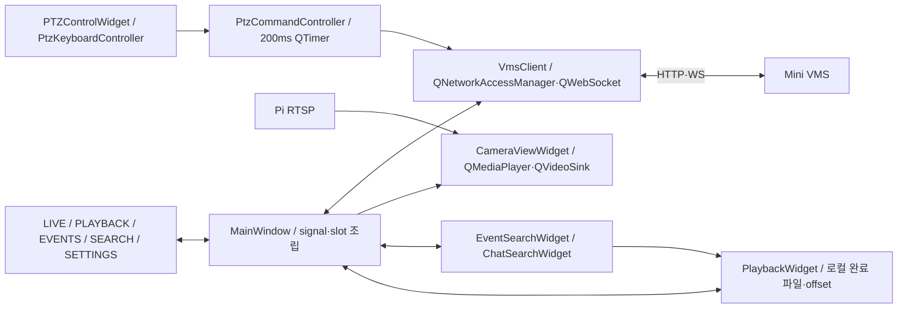

# Qt Mini VMS 현재 아키텍처

2026-10-11 작업 트리 기준. [전체 시스템](SYSTEM_ARCHITECTURE.md)

## 책임

| 모듈 | 실제 역할 |
|---|---|
| app | 위젯 구성·선택 카메라·상태 배분 |
| network | WS 요청 ID·timeout·상태 알림, HTTP direct-stream URI 조회 |
| camera | Pi 직접 RTSP 재생·영상 좌표와 bbox 표시 |
| ui | PTZ 버튼/키보드·누름 갱신·Tracking 요청/상태 구분 |
| device | SETTINGS 연결·검색·등록·상세 상태 |
| events / chat | VMS 결과와 페이지 표시, 재생 위치 조회 |
| playback | 완료 파일 열기·ms 탐색·목록 복귀 |
| model / log / demo / legacy | 표시 자료형·로그·명시적 데모·별도 이전 앱 |

Qt의 QTimer 갱신은 GUI 이벤트 루프에서 수행하며 별도 추론 스레드를 만드는 동작이 아니다.
네트워크는 Qt 비동기 신호를 사용한다. ONVIF·SQLite·Gemini 처리는 서버 책임이다.

## 화면·수명 규칙

LIVE가 기본이며 장치/계정/서버 설정은 SETTINGS에 모은다. 다른 페이지로 이동하면 수동
PTZ 입력을 정리하고 단축키를 제한한다. 영상·녹화·Tracking을 페이지 변경만으로 종료하지 않는다.
늦은 응답은 요청 ID·카메라/연결 세대로 걸러낸다. PI_ACKNOWLEDGED는 모터 도착 확인이 아니다.

PLAYBACK의 `← 목록으로`는 재생 자원과 선택을 정리하고 검색 조건·목록을 유지한다.
녹화 파일은 Qt에서 접근 가능한 로컬 경로여야 한다. 원격 다운로드 서버는 구현되어 있지 않다.
현재 수동 버튼/키보드 속도는 정규화 1.0이며 실제 각속도는 Pi 설정과 기구에 따라 달라진다.

## 코드·빌드 안내

최상위 CMake가 진입점이며 `PTZCamera/` 경로와 legacy target을 유지한다.
[실행·빌드](../README.md) · [코드 안내](../PTZCamera/docs/CODE_GUIDE.md) ·
[UI 배치](../PTZCamera/docs/UI_LAYOUT.md) · [기술 결정](../PTZCamera/docs/tech-decisions/)
